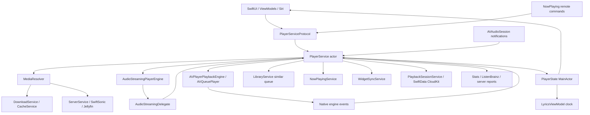
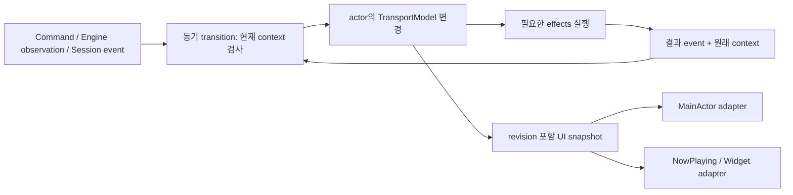

# Cassette 코드베이스 감사 및 재생 아키텍처 개선안

작성일: 2026-10-13. 대상: `/Users/kyumin/Cassette`의 **현재 작업 트리**. 기준 HEAD: `e2cc0e5f6434c19eb8db88623723d6ae92f6b0fc`.

**앱·테스트·설정 소스는 수정하지 않았다.** 이 보고서와 감사 목록만 추가했다. 기존 변경 사항과 미추적 파일도 분석 대상에 포함했으며, HEAD 버전만 분석한 결과가 아니다. 파일별 행 수와 SHA-256은 [source-inventory.json](source-inventory.json), 당시 변경 목록은 [working-tree-status.txt](working-tree-status.txt)에 기록했다. 아래 코드 위치는 이 작업 트리 기준이며 이후 편집 시 달라진다.

## 1. 판단과 검증 범위

가장 시급한 문제는 파일 크기 자체보다 **재생 명령의 유효성, 복구 시도, UI 상태, 청취 시간 집계가 같은 흐름 안에서 서로 다른 기준으로 변경되는 것**이다. `PlayerService`는 actor이고 사실상 재생의 단일 소유자다. 그러나 UI에 놓인 `PlayerState`, 실제 엔진, 복구 플래그, 큐와 저장 세션을 하나의 원자적인 상태로 취급하지 못하는 구간이 있다. actor는 동시 메모리 접근을 직렬화하지만 `await` 전후의 논리적 순서까지 보장하지 않는다.

우선순위는 다음과 같다.

1. 중간 버퍼링의 로컬 복구 조건 모순, 복구 실패 후 미완료 상태, 큐 끝에서 사용자 의도를 무시하는 흐름을 수정한다.
2. 오류·인터럽션을 공통 종료/일시정지 처리로 연결하고, 모든 비동기 완료가 요청·계정·큐 항목의 식별자를 확인하게 한다.
3. 세션 저장에 계정과 재생 항목 식별자를 넣는다. 청취 기록 마이그레이션의 실패 처리를 바로잡는다.
4. 위 동작을 테스트로 고정한 뒤, 같은 actor 안에 상태 전환과 복구 정책의 경계를 만든다.
5. 실제 기기에서 재생·메모리·전력 기준선을 확보한 뒤 이미지 작업, 오디오 탭, 디스크 I/O를 최적화한다.

**Critical로 단정할 증거는 발견하지 못했다.** High 항목도 실제 기기에서 모두 재현한 것은 아니다. 아래에서 “확인”은 코드의 조건·호출 경로로 확인한 결함/동작을 뜻하고, “위험”은 특정 스케줄링·서버·기기 조건에서 결과가 발생할 수 있어 추가 재현이 필요한 경우를 뜻한다. 처리량·배터리 개선률은 측정하지 않았으며 수치를 제시하지 않는다.

### 1.1 코드 범위와 분석 깊이

| 영역 | Swift 파일 | 행 수 | 분석 내용 |
|---|---:|---:|---|
| Cassette 앱 | 561 | 94,336 | 전체 구조·심볼·비동기/상태/저장소 사용 검색, 주요 호출 경로 추적 |
| 앱 단위 테스트 | 121 | 20,794 | 실행 및 재생/복구/취소/계정 격리 테스트의 범위 대조 |
| UI 테스트 | 3 | 188 | 구성 확인; 이번 감사에서 실행하지 않음 |
| 로컬 SwiftSonic 패키지 | 92 | 13,358 | 소스와 테스트 포함. 요청·디코딩·재시도·설정 연결 추적 |
| 위젯 확장 | 13 | 818 | 공유 상태 생산자/소비자와 계정 경계 확인 |

앱은 Services 144개, Views 147개, DesignSystem 89개, Models 62개, Siri 35개, Utilities 33개, ViewModels 27개 등으로 구성된다. `PlayerService` 본체와 확장 **17개 파일, 5,878행**은 같은 actor의 저장 프로퍼티를 공유한다. 파일 분리는 이미 되어 있지만 책임과 변경의 경계가 분리된 것은 아니다.

심층 추적한 영역은 재생 엔진/명령/seek/EOF/gapless/복구/인터럽션, Now Playing, 재생 세션·집계, 미디어 해석·다운로드·캐시, 라이브러리 인덱스, 가사 추적, 이미지 디코딩과 렌더링, 앱 조립·로그아웃·마이그레이션이다. 그 밖의 화면·Siri·외부 서비스는 전체 목록과 호출부, 공통 인프라 연결을 중심으로 검토했다. **791개 Swift/Metal 파일의 목록화가 모든 줄·모든 실행 경로의 수동 검증을 뜻하지는 않는다.** 서드파티 바이너리, 실제 서버 구현, CloudKit 충돌의 실기기 동작은 별도 검증 범위다.

### 1.2 실제 실행한 검증

| 검증 | 결과 | 의미와 한계 |
|---|---|---|
| Xcode 27.2, build 27B5028f, macOS `CassetteTests` | **1,083 tests / 186 suites 통과**, Swift Testing 실행 65.994초, `TEST SUCCEEDED` | 현재 macOS 구성의 회귀 테스트가 통과함. iOS 오디오 세션 분기는 증명하지 않음 |
| `Cassette`, generic iOS Simulator 빌드 | **BUILD SUCCEEDED** | iOS 전용 소스의 컴파일 확인. 시뮬레이터/기기 실행은 아님 |
| 사용 가능한 iOS 시뮬레이터 조회 | iOS 27.2 런타임의 등록된 기기 없음 | iOS 단위·UI 테스트를 실행하지 못함 |
| Instruments / 실기기 연속 재생 | 미실행 | 재생 지연·끊김·누수·전력·실측 gapless 수치 없음 |
| SwiftSonic 독립 패키지 테스트 | 미실행 | 앱 빌드와 앱 테스트 통과를 패키지 전체 테스트 통과로 확대하지 않음 |

재현 명령과 로그는 다음과 같다. 빌드 산출물은 기존 DerivedData 및 `/tmp`에 생성했다.

```sh
xcodebuild test -project Cassette.xcodeproj -scheme CassetteTests \
  -destination 'platform=macOS' -derivedDataPath .derivedData-test \
  -disableAutomaticPackageResolution -parallel-testing-enabled NO \
  -resultBundlePath /tmp/cassette-audit-20261013-verified.xcresult \
  CODE_SIGNING_ALLOWED=NO

xcodebuild build -project Cassette.xcodeproj -scheme Cassette \
  -destination 'generic/platform=iOS Simulator' -derivedDataPath .derivedData-ios \
  -disableAutomaticPackageResolution CODE_SIGNING_ALLOWED=NO
```

로그: `/tmp/cassette-audit-20261013-verified-tests.log`, `/tmp/cassette-audit-20261013-ios-build.log`. 초기 샌드박스 실행은 시스템 캐시 접근으로 실패했고, 허용된 실행에서 위 결과를 얻었다. 이는 앱 테스트 실패와 구분한다.

## 2. 현재 호출 관계와 상태 소유권



| 값/책임 | 실제 소유 위치 | 경계의 문제 |
|---|---|---|
| 현재 곡·큐·인덱스·UI phase·위치 | `PlayerState`, MainActor | actor가 상태 판단 때 다시 읽음. 상태와 UI가 동시에 의사결정의 입력 |
| 실제 소스·활성 엔진·seek/restore/복구 | `PlayerService` 및 엔진 | UI 상태와 별도로 유효성을 판단하며 부분 갱신 가능 |
| 요청의 유효성 | playbackEpoch, transportCommandID, seekRequestGeneration, system generation 등 | 각각 유용하지만 모든 경로에서 동일하게 적용되지 않음 |
| 오디오 실행 사실 | AudioStreaming state / AVPlayer timeControl / progress | 세 경로가 `.playing` 확인과 복구를 수행 |
| 큐 연장 | `+Queue`, `+Controls`, LibraryService | 일반 auto-extend와 큐 끝 fallback의 정책이 다름 |
| 외부 표시 | NowPlayingService, WidgetSyncService | 요청 버전 없는 일부 전달 경로와 독립 rate/playing 값 |
| 저장 위치 | PlaybackSessionService의 전역 `current` | 계정/트랙과 위치 checkpoint를 연결할 식별자 부족 |

관찰한 앱 코드에서 여러 독립 객체가 제멋대로 `PlayerState.playbackState`를 변경하는 패턴이 핵심 문제는 아니다. 주요 작성자는 같은 `PlayerService`의 확장들이다. 다만 `PlayerState`의 transport 필드에 강한 쓰기 제한이 없고, **단일 객체 소유권은 있으나 단일 전환 절차는 없다.** 따라서 새 복구 경로를 추가할 때 기존 모든 플래그·타이머·표시·집계 처리의 지식을 요구한다.

이미 갖춘 기반도 유지해야 한다.

- 엔진 프로토콜, 미디어 해석 프로토콜, seek 상태 모델, 순수 gapless/버퍼/품질 정책과 테스트가 있다.
- native 엔진은 generation, item ID, seek sequence를 확인하며 observer·task를 정리한다.
- 이미지 캐시는 크기별 다운샘플링, 110개/48 MiB 비용 제한, 동시 디코딩 제한을 사용한다.
- 다운로드는 계정·세대 검사, 작업 합류, 파일 검증·설치 journal, 취소 후 정리 경로를 갖춘다.
- 네트워크 목록 요청 일부는 합류·캐시되고, 앱이 만드는 SwiftSonic 클라이언트는 `retryPolicy: .none`이다. 패키지 기본 재시도를 보고 앱에서 중복 쓰기가 발생한다고 판단하면 안 된다.
- 가사 추적은 표시·재생 상태에 따라 동작하고, 색상 분석·검색 인덱스 계산 일부는 main 밖에서 실행한다.
- NowPlayingService의 player 역참조에 대응하는 `PlayerService.nowPlayingService`는 weak다. 이 관계를 새 retain cycle로 지적할 근거는 없다.

## 3. 발견 사항: 우선순위와 상세 근거

비용은 S(국소 수정), M(몇 컴포넌트 및 테스트), L(저장 스키마/엔진 경계 등 넓은 변경)의 상대 비교다. 기간 추정이 아니다. 우선순위는 심각도에 더해 재현 가능성, 수정 비용, 영향 범위를 고려했다.

| 순서 | ID | 문제 | 판정 | 심각도 | 비용 / 수정 회귀 위험 |
|---:|---|---|---|---|---|
| 1 | F01 | 중간 stall에서 로컬 파일 복구 조건이 성립하지 않음 | 확인 | High | S–M / 중 |
| 2 | F02 | 소스 refresh 실패 후 복구 시도만 소진됨 | 확인, 정지 지속은 조건부 | High | S–M / 중 |
| 3 | F03 | 큐 끝 fallback이 auto-extend 설정·후속 pause를 무시 | 확인 + 순서 위험 | High | S–M / 중 |
| 4 | F04 | 오류/인터럽션의 정리 누락과 청취 시간 과다 집계 | 확인 | High | M / 중 |
| 5 | F05 | 인터럽션 hard pause가 진행 중 play를 무효화하지 않음 | 위험 | High | M / 중 |
| 6 | F06 | legacy 기록 읽기 실패를 마이그레이션 완료로 처리 | 확인 | High | S / 낮음 |
| 7 | F07 | 저장 세션과 위치 checkpoint의 계정·트랙 식별자 부재 | 확인된 설계 결함 | High | L / 높음 |
| 8 | F08 | cold resume·repeat-one·추천 재생의 오래된 완료 가능성 | 위험 | High | M / 중–높음 |
| 9 | F09 | Media Services reset 때 오디오 객체 재구성과 사용자 의도 처리 부족 | 확인 + 기기 위험 | High | M / 높음 |
| 10 | F10 | 동일 곡의 다른 큐 항목을 중복 요청으로 오인 | 확인 | Medium | S / 낮음 |
| 11 | F11 | native 엔진에서 ReplayGain 적용 경로 없음 | 확인 | Medium | M–L / 높음 |
| 12 | F12 | native 곡 전환의 fade-out/fade-in 정책 불일치 | 확인 | Medium | M / 중 |
| 13 | F13 | 손실 코덱을 서버 트랜스코딩으로 표시 | 확인 | Medium | S / 낮음 |
| 14 | F14 | 위젯 throttle이 최종 재생 상태를 버림 | 확인 | Medium | S / 낮음 |
| 15 | F15 | 엔진 오류 원인·이벤트 식별자 손실 | 확인된 구조 결함 + 순서 위험 | Medium | M / 중 |
| 16 | F16 | Now Playing 위치 갱신에 트랙·명령 버전 없음 | 위험 | Medium | M / 중 |
| 17 | F17 | 오디오 분석 callback에서 배열 할당·Task 생성 | 실시간 안전성 위험 | High | M / 중 |
| 18 | F18 | 취소된 이미지 대기 작업도 디코딩 수행 | 확인, 성능 영향 미측정 | Medium | S–M / 중 |
| 19 | F19 | 상세 라이브러리 캐시의 크기·수명 제한 부재 | 확인, 메모리 영향 미측정 | Medium | M / 중 |
| 20 | F20 | 대형 인덱스 파일 쓰기와 초기 migration이 MainActor에서 실행 | 확인, 지연 미측정 | Medium | M / 중 |
| 21 | F21 | 스트림과 전체 파일 캐시의 전송 중복 및 자원 조율 범위 | 조건부 비용/위험 | Medium | M–L / 높음 |
| 22 | F22 | 가사 단어별 반복 문자열 분석과 무캐시 레이아웃 | 비용 위험 | Low | S–M / 낮음 |

### F01. 중간 stall의 로컬 복구에 초기 acquisition 조건을 재사용

- **판정·심각도:** 확인된 조건 모순, High. 기기 재생을 통한 재현은 미실행.
- **위치·함수:** [Cassette/Services/Implementations/PlayerService+Engine.swift:168](/Users/kyumin/Cassette/Cassette/Services/Implementations/PlayerService+Engine.swift:168) `recoverFromStalledStream`, `:329` `recoverAcquiringPlaybackFromLocalMedia`, `:302` `shouldRecoverAcquiringPlayback`.
- **원인·재현 조건:** 상위 경로는 `engineProgress >= 0.25`인 재생 중단만 받는다(`:173`). 로컬 fallback은 다시 초기 재생용 조건인 progress `< 0.25` 및 loading/playing을 요구한다. 이미 60초 재생했고 다운로드/캐시 파일이 준비된 채 시계가 멈추면, 로컬 파일을 찾더라도 전환이 거부된다. 두 검사 사이에 엔진 시계가 별도로 초기화되는 특수 상황은 제외한다.
- **영향:** 사용 가능한 오프라인 파일을 두고 네트워크 refresh에 의존한다. 끊김 지속, 추가 요청, 복구 정책의 이해 비용이 증가한다.
- **권장 수정·효과:** 로컬 소스 조회는 재사용하되 “초기 열기”와 “진행 중 stall”의 자격 검사를 분리한다. 후자는 현재 요청/항목/seek/사용자 의도를 검증하고 **현재 위치를 유지**하여 재시작한다. 예외마다 새 엔진을 만드는 설계는 필요 없다.
- **영향 컴포넌트·위험:** Engine, Progress, DownloadService 완료 알림, seek/restore. 버퍼링마다 무조건 로컬 전환하면 잘못된 곡·위치로 이동할 수 있어 token 검사가 선행되어야 한다.
- **회귀·성능 검증:** fake engine progress=60, remote source, local file 존재, buffering/playing 각각에서 로컬 resolve 1회와 위치 보존 검증. pause/seek/다음 곡 중 완료는 폐기. 실기기 네트워크 단절 후 복구 시간과 중복 GET을 비교한다.

### F02. stall refresh 실패가 복구 절차의 종료로 이어지지 않음

- **판정·심각도:** 확인된 실패 처리 누락, High. 엔진 자체 reconnect가 성공하면 사용자 증상은 사라질 수 있다.
- **위치·함수:** [PlayerService+Engine.swift:168](/Users/kyumin/Cassette/Cassette/Services/Implementations/PlayerService+Engine.swift:168) `recoverFromStalledStream`, 특히 `:187`, `:207`, `:217`; `:222` `scheduleStallRecoveryCompletion`.
- **원인·재현 조건:** refresh 전에 `recoveredCurrentStall=true`로 설정한다. resolve가 throw하면 로그만 남긴다. 성공 분기에서만 완료 감시를 예약하므로 실패 시 bounded 종료가 없다. 이후 stall은 해당 플래그로 거부된다. 재생 중 서버 연결을 끊어 refresh도 실패시키면 노출된다.
- **영향:** buffering/playing 의도 상태와 실제 무음의 장기 불일치 가능성. 재생 중 네트워크 복구를 사용자가 수동으로 해소해야 할 수 있다.
- **권장 수정·효과:** `idle → attempting → waitingForProgress → completed/failed/cancelled` 수준의 작은 복구 수명 모델을 둔다. 실패 시 현재 요청인지 확인한 뒤 사용자 재시도 가능한 terminal 상태 또는 제한된 backoff로 끝낸다. 단순히 Bool을 false로 돌려 무한 재시도시키지 않는다.
- **영향 컴포넌트·위험:** native watchdog, 공통 stall monitor, acquisition task, 오류 UI. 중복 복구를 막는 기존 보호를 제거하면 네트워크 폭주와 엔진 재시작 반복이 발생한다.
- **회귀·성능 검증:** resolver throw/timeout/cancel, 자체 엔진 회복, pause 중 refresh 완료, 연속 stall. 테스트 시계를 사용해 유한 시간 내 종료와 엔진 재시작 최대 횟수를 확인한다.

### F03. 큐 끝 fallback이 auto-extend 비활성화 및 새 사용자 명령을 존중하지 않음

- **판정·심각도:** 설정 무시와 영구 true 저장은 확인, 후속 pause 무시는 순서 위험. High.
- **위치·함수:** [PlayerService+Controls.swift:480](/Users/kyumin/Cassette/Cassette/Services/Implementations/PlayerService+Controls.swift:480) `skipToNext`, `:507` `continueWithSimilarTracksAfterQueueEnd`, `:520` 설정 변경; 비교 경로 [PlayerService+Queue.swift:85](/Users/kyumin/Cassette/Cassette/Services/Implementations/PlayerService+Queue.swift:85) `setAutoExtendEnabled`, `:100` `evaluateAutoExtend`.
- **원인·재현 조건:** 큐 마지막에서 repeat-all이 아니면 auto-extend 값 검사 없이 유사곡을 가져온다. 성공하면 설정을 true로 바꾸어 저장한다. 기존 일반 auto-extend 경로는 설정을 검사한다. 추천 fetch는 playbackEpoch만 확인하며, 정상 곡을 pause하는 명령은 항상 epoch를 변경하지 않는다.
- **영향:** 자동 재생을 끈 사용자의 선택이 변경된다. 마지막 곡에서 next를 누르고 추천 응답 전에 pause하면 늦은 응답이 재생을 시작할 수 있다. 실패 후 `pauseAtEndOfQueue`도 오래된 작업인지 검사해야 한다.
- **권장 수정·효과:** 큐 끝과 사전 연장의 동일한 정책 함수를 사용한다. 설정 변경은 명시적 사용자 명령만 수행한다. fetch 시작 시 command/queue revision/account를 캡처하고 적용 전 확인한다. 취소·superseded와 “곡 없음”을 서로 다른 결과로 전달한다.
- **영향 컴포넌트·위험:** Controls, Queue, Gapless EOF, LibraryService, 설정 저장. 자동 연장의 기존 사용자 경험을 유지하되 off의 계약을 일관되게 한다.
- **회귀·성능 검증:** auto off에서 네트워크 호출 0·설정 false 유지·끝에서 pause; on에서는 기존 연장. fetch 도중 pause/새 큐/계정 변경/설정 off, 빈 응답·에러를 순서 제어 테스트로 확인한다. 기존 `lateAutoplayResultsRespectCurrentPolicyAndDeduplicate`는 `applyAutoExtend`를 검사하며 이 별도 fallback 전체를 대신하지 않는다.

### F04. 오류·인터럽션·cold resume의 집계 및 정리 동작 불일치

- **판정·심각도:** 확인된 로직 결함, High.
- **위치·함수:** [PlayerService+Callbacks.swift:135](/Users/kyumin/Cassette/Cassette/Services/Implementations/PlayerService+Callbacks.swift:135) `handleAudioStateChanged(.error)`, `:149` `handleAudioError`; [PlayerService+AudioSession.swift:345](/Users/kyumin/Cassette/Cassette/Services/Implementations/PlayerService+AudioSession.swift:345) `applyHardInterruptionPause`; [PlayerService+Controls.swift:123](/Users/kyumin/Cassette/Cassette/Services/Implementations/PlayerService+Controls.swift:123) `resume`; [PlayerService+Reporting.swift:38](/Users/kyumin/Cassette/Cassette/Services/Implementations/PlayerService+Reporting.swift:38) `fireScrobbleIfThresholdMet`, `:61` `finalizePlaySegment`, `:76` `recordCurrentTrackPlayback`.
- **원인·재현 조건:** AudioStreaming terminal 오류는 `.error(.timeout)`만 게시한다. progress 작업과 현재 청취 segment를 닫지 않는다. scrobble 검사는 재생 phase를 확인하지 않고 벽시계 경과를 더한다. hard interruption pause도 segment를 닫지 않는다. cold resume는 실제 오디오 확인 전에 segment를 시작한다.
- **영향:** 무음·통화·재연결 대기 시간이 청취 시간에 포함될 수 있고, 오류 뒤에도 주기 작업이 남는다. 잠금 화면 rate 및 위젯도 같은 terminal 전환으로 정리되지 않아 표시 일관성이 떨어진다.
- **권장 수정·효과:** 실제 오디오가 흐르기 시작한 순간만 segment를 연다. waiting/interruption/pause/terminal error에서 한 번 닫고, terminal 처리 한 곳에서 타이머·예정 복구·rate·checkpoint를 정리한다. 누적 시간은 테스트 가능한 monotonic clock을 사용한다. 재생 실패가 곧 “자연 완료”가 되지 않게 한다.
- **영향 컴포넌트·위험:** Stats, ListenBrainz, OpenSubsonic/Jellyfin reporting, NowPlaying, checkpoint. 스크로블 중복과 기존 청취 기록 호환성에 주의한다. 과거 기록을 임의로 재작성하지 않는다.
- **회귀·성능 검증:** 20초 재생 → 60초 오류/통화 → 다음 곡에서 청취 20초만 기록. buffering 시간 제외, cold resume 대기 제외, terminal callback 두 번에도 finalization 1회. 오류 후 tasks/wakeups와 외부 rate=0을 확인한다.

### F05. 인터럽션 hard pause가 진행 중 play/acquisition의 권한을 취소하지 않음

- **판정·심각도:** 순서상 위험, High. iOS 실기기 재현 필요.
- **위치·함수:** [PlayerService+AudioSession.swift:345](/Users/kyumin/Cassette/Cassette/Services/Implementations/PlayerService+AudioSession.swift:345) `applyHardInterruptionPause`, `:366` `handleAudioSessionInterruption`; [PlayerService+Transition.swift:60](/Users/kyumin/Cassette/Cassette/Services/Implementations/PlayerService+Transition.swift:60) `performPlay`, `:251` `startPlayback`.
- **원인·재현 조건:** 일반 `pause()`와 달리 hard pause는 transportCommandID 증가, playback 요청 취소, acquisition 취소를 수행하지 않는다. 곡 URL resolve가 대기하는 동안 interruption이 시작되고 hard pause 후 resolve가 성공하면, 기존 play는 여전히 유효한 요청으로 엔진 시작을 시도할 수 있다. 오디오 세션이 시작을 거부하더라도 UI/복구 상태는 어긋날 수 있다.
- **영향:** 통화·Siri·출력 분리 과정의 재생 시도, pause 상태 덮어쓰기, 인터럽션 종료 후 중복 resume 가능성.
- **권장 수정·효과:** 외부 인터럽션도 재생 허용 상태를 변경하는 명령으로 받아 pending start/seek/recovery를 무효화한다. 사용자 의도와 “현재 세션에서 실행 가능”을 분리하고, 종료 시 기존 shouldResume/routeDisconnect/screenshot 정책을 한 번 평가한다.
- **영향 컴포넌트·위험:** iOS 세션, play/seek/acquisition, route 전환. screenshot 특례를 근거 없이 제거하거나 모든 interruption 종료를 자동 재생으로 바꾸지 않는다.
- **회귀·성능 검증:** suspend 가능한 resolver로 `play → interruption began → hard pause → resolve 성공` 재현. ended 전 engine play 0, ended 후 조건 충족 시 1회. 사용자 pause와 AirPods 분리 시 자동 재개 금지. 실제 전화·Siri·스크린샷 조합 검증.

### F06. 청취 기록 마이그레이션의 읽기 실패를 성공으로 표시

- **판정·심각도:** 확인된 실패 분기 결함, High.
- **위치·함수:** [Cassette/App/AppContainer.swift:689](/Users/kyumin/Cassette/Cassette/App/AppContainer.swift:689) `migratePlaybackEventsIfNeeded`, 특히 `:695–700`.
- **원인·재현 조건:** `try? source.fetch` 실패와 정상적인 빈 배열을 같은 guard로 처리하면서 완료 UserDefaults를 true로 저장한다. 목적지 fetch 실패도 빈 목록으로 처리해 중복 판단을 잃는다.
- **영향:** 일시적인 저장소 오류 후 legacy 기록 복사가 영구적으로 재시도되지 않을 수 있다. 목적지 읽기 실패 뒤에는 동일 ID 기록을 재삽입할 위험이 있다. 원본 삭제를 확인한 것은 아니며 “데이터가 즉시 삭제된다”는 결론은 아니다.
- **권장 수정·효과:** fetch 실패, 정상 empty, 성공을 do/catch로 분리한다. 모든 필수 읽기와 저장이 성공했을 때만 완료 표시한다. 재실행 가능한 ID 기반 batch migration을 유지한다.
- **영향 컴포넌트·위험:** AppContainer, PlaybackEvent, Stats/CloudKit store. 수정 자체는 작지만 실제 사용자 저장소로 실험하지 않는다.
- **회귀·성능 검증:** source/destination fetch 실패 주입 시 완료 flag=false. 다음 실행 성공 시 정확히 한 번 복사. 부분 완료·기존 ID·큰 기록 수 테스트. 실제 데이터 규모에서 launch time을 별도 측정한다.

### F07. 계정·큐 항목과 분리된 전역 재생 세션/checkpoint

- **판정·심각도:** 확인된 식별자 결함, High. 계정 전환 재현은 별도 필요. **현재 [AppContainer.swift:533](/Users/kyumin/Cassette/Cassette/App/AppContainer.swift:533)의 `isCloudKitSyncEnabled=false`이므로 기기 간 CloudKit 충돌은 동기화 활성화 시의 잠재 위험**이며 현 빌드에서 관찰된 현상이 아니다.
- **위치·함수:** [Cassette/Models/Persistence/PlaybackSession.swift:18](/Users/kyumin/Cassette/Cassette/Models/Persistence/PlaybackSession.swift:18) 모델; [PlaybackSessionService.swift:58](/Users/kyumin/Cassette/Cassette/Services/Implementations/PlaybackSessionService.swift:58) `savePosition`, `:164` LWW consolidation; [PlayerService+Session.swift:21](/Users/kyumin/Cassette/Cassette/Services/Implementations/PlayerService+Session.swift:21) `saveCurrentPosition`, `:70` `restoreSession`.
- **원인·재현 조건:** 세션은 전역 `id="current"`이고 서버/계정 식별자가 없다. restore는 복원 작업 도중 active server가 바뀌지 않았는지만 확인한다. 저장했던 계정과 일치하는지는 알 수 없다. `savePosition(Double)`은 현재 저장소의 LWW winner 트랙을 확인하지 않고 위치만 덮어쓴다. 이 저장소는 현 구성에서는 로컬이며 CloudKit용 스키마/병합 경로가 준비되어 있다.
- **영향:** 계정 A 세션을 B에서 복원하면 A 메타데이터의 ID를 B 서버에 해석할 수 있다. 동기화 활성화 후에는 다른 기기가 새 곡/큐를 저장한 뒤 이전 기기의 위치 checkpoint가 그 새 세션에 결합할 수 있다. 현재 트랙·큐·위치의 일관성을 지킬 식별자가 필요하다.
- **권장 수정·효과:** 안정적인 계정 scope, queue revision, queue occurrence ID, session writer/revision을 저장하고 checkpoint에 함께 전달한다. 대상 세션이 다르면 쓰기를 거절한다. 기기 간 이어듣기를 유지하려면 기기별 임시 UUID만으로 scope를 구성하지 말고, 기존 계정 식별·동기화 정책과 맞춘다. 기존 행은 소속 확인 후 migration하거나 복원 보류한다.
- **영향 컴포넌트·위험:** SwiftData/CloudKit schema, SessionPayload/RestoredSession, player, logout/account. 비용·회귀 위험이 크다. **로그아웃 시 전체 CloudKit 청취 기록을 삭제하는 방식으로 해결하지 않는다.** 구버전 앱 동시 사용도 고려한다.
- **회귀·성능 검증:** 현 구성에서 A/B 같은 song ID, 다른 ID, 재로그인, 오래된 checkpoint와 새 세션의 충돌을 테스트한다. 동기화 활성화 전에 두 기기 큐 변경·중복 CloudKit 행·migration도 검증한다. 저장 횟수·직렬화 시간과 기존 복원 위치/queue order/repeat 호환성을 확인한다.

### F08. 비동기 결과 적용 직전의 명령·계정 검사 누락

- **판정·심각도:** 논리적 race 위험, High. 메모리 data race를 확인했다는 뜻은 아니다.
- **위치·함수:** [PlayerService+Controls.swift:158,183](/Users/kyumin/Cassette/Cassette/Services/Implementations/PlayerService+Controls.swift:158) `resume`; [PlayerService+Gapless.swift:241](/Users/kyumin/Cassette/Cassette/Services/Implementations/PlayerService+Gapless.swift:241) repeat-one 분기, `:575` `pauseAtEndOfQueue`; [PlayerService+Queue.swift:21](/Users/kyumin/Cassette/Cassette/Services/Implementations/PlayerService+Queue.swift:21) `playSmartShuffle`; [LibraryService.swift:545](/Users/kyumin/Cassette/Cassette/Services/Implementations/LibraryService.swift:545) `onlineSmartShuffle`, `:600` `similarBackfillQueue`, `:731` `topSongs`.
- **원인·재현 조건:** cold resume는 source 검증 후 MainActor 게시를 await하고 바로 engine start를 실행한다. 그 사이 새 pause가 처리되면 검증이 오래된다. repeat-one은 history await 이후 epoch 재검사가 없다. smart shuffle은 곡 fetch 이전 명령/계정 식별자를 보존하지 않고 완료 후 `play`한다. 일부 Library 메서드는 다른 메서드에 있는 request token 검사를 생략한다.
- **영향:** 오래된 추천이 새 사용자 선택을 대체하거나, 이전 EOF가 새 곡을 다시 시작/정지시키거나, 이전 계정 데이터가 새로운 재생 요청으로 포장될 가능성.
- **권장 수정·효과:** 모든 대기마다 무작정 guard를 복사하지 말고 **효과 실행 직전과 상태 commit 시** 공통 request context를 확인한다. 추천 결과에는 계정 identity를 포함한다. 취소된 `play`가 정상 완료처럼 후속 smart 상태를 켜지 않도록 내부 결과를 applied/superseded/failed로 구분한다.
- **영향 컴포넌트·위험:** Controls, Gapless, Queue, LibraryService, MainActor projection. 오류 수정이 정상 gapless의 추가 await/지연으로 이어지지 않게 synchronous commit 경계를 먼저 만든다.
- **회귀·성능 검증:** resolver/추천/기록 저장을 controllable continuation으로 중지하고 그 사이 pause, play B, account switch를 주입한다. 새 명령 뒤 이전 엔진 효과와 상태 게시가 0임을 검증한다. 반복곡·빠른 skip의 엔진 start 수와 전환 지연을 비교한다.

### F09. Media Services reset 대응이 객체 재생성 대신 기존 엔진 재개에 의존

- **판정·심각도:** 공식 복구 지침과 다른 처리 확인, 재생 실패는 기기 위험. High.
- **위치·함수:** [PlayerService+AudioSession.swift:299](/Users/kyumin/Cassette/Cassette/Services/Implementations/PlayerService+AudioSession.swift:299) `handleMediaServicesReset`; `PlayerService.swift`의 장수명 engine/systemEngine; [ReplayGainService.swift:11](/Users/kyumin/Cassette/Cassette/Services/Implementations/ReplayGainService.swift:11) EQ graph.
- **원인·재현 조건:** 세션 플래그를 초기화하고 setActive를 다시 호출한 뒤 기존 엔진에 seek/resume한다. 엔진·EQ 등 오디오 객체를 재생성하는 경로가 없고, 이전 재생 의도가 있으면 자동 resume한다.
- **영향:** media server reset 후 무음/오래된 graph 유지 가능성과 사용자 의도 정책 불일치. 일반 interruption recovery와 같은 방식으로 처리하기 어렵다.
- **권장 수정·효과:** reset 이벤트에서 pending 작업·엔진 세대를 무효화하고 위치/큐를 보존한다. 영향을 받은 오디오 객체를 다시 만들 수 있는 좁은 factory 경계를 둔다. 사용자 재생 요청에 의해 활성화한다. Apple은 reset 후 오디오 객체와 세션 설정을 재초기화하고 사용자 동작 전 재생을 재시작하지 않도록 안내한다. [Apple 문서](https://developer.apple.com/documentation/AVFAudio/AVAudioSession/mediaServicesWereResetNotification)
- **영향 컴포넌트·위험:** 두 엔진, EQ, native tap, NowPlaying session, AVAudioSession. 교체 범위가 넓어 mock 테스트만으로 완료 판정하지 않는다.
- **회귀·성능 검증:** 개발자 설정 Reset Media Services로 playing/paused/loading/seek 중 각각 검증. 새 graph/observer 수, 이전 callback 무시, 저장 위치·큐 보존, 사용자 play 이후 소리 확인. 반복 reset 후 객체 수가 누적되지 않는지 측정한다.

### F10. 같은 곡의 다른 큐 occurrence가 중복 시작으로 무시됨

- **판정·심각도:** 확인된 조건 결함, Medium.
- **위치·함수:** [PlayerService+Transition.swift:88–104](/Users/kyumin/Cassette/Cassette/Services/Implementations/PlayerService+Transition.swift:88) `performPlay`의 alreadyPlaying 검사.
- **원인·재현 조건:** 곡 ID, 전체 큐 ID 배열, 위치 >2초와 playback intent가 같으면 요청을 무시하지만 현재 index와 요청 index를 비교하지 않는다. 큐 `[A, A]`에서 첫 A를 재생하다 두 번째 A로 next/선택할 때 해당된다.
- **영향:** 정상적인 중복곡 큐를 넘길 수 없거나 잘못된 currentIndex를 유지한다. gapless 준비의 명시적 advance보다 검사 순서가 앞선다.
- **권장 수정·효과:** 우선 현재 index까지 비교한다. 장기적으로 큐 항목에 occurrence ID를 부여하여 곡 identity와 재생 항목 identity를 분리한다. 동일 항목 재전송 방지는 유지한다.
- **영향 컴포넌트·위험:** queue selection, skip, repeat, gapless. 중복곡을 큐에서 제거하는 해결책은 기능 변경이므로 피한다.
- **회귀·성능 검증:** `[A,A]`, `[A,B,A]`, 동일 항목 재전송, 서로 다른 큐에서 같은 곡 선택. 올바른 index와 정확한 엔진 시작 횟수를 확인한다.

### F11. native 재생 경로에 ReplayGain 효과가 연결되지 않음

- **판정·심각도:** 확인된 기능 차이, Medium.
- **위치·함수:** [ReplayGainService.swift:11–42](/Users/kyumin/Cassette/Cassette/Services/Implementations/ReplayGainService.swift:11) `attach/apply`; [PlayerService.swift:365](/Users/kyumin/Cassette/Cassette/Services/Implementations/PlayerService.swift:365) `setReplayGainService`; `PlayerService+Engine.swift` `startEnginePlayback`; [PlayerService+Queue.swift:48](/Users/kyumin/Cassette/Cassette/Services/Implementations/PlayerService+Queue.swift:48) `replayGainSettingsDidChange`.
- **원인·재현 조건:** gain은 AudioStreaming graph에 붙인 AVAudioUnitEQ에 적용된다. native AVPlayer 경로에는 같은 gain 효과가 전달되지 않는다. macOS 및 iOS에서 native가 선택되는 소스·경로에서 발생한다.
- **영향:** 설정은 켜져 있어도 엔진 전환 전후 음량 정책이 달라진다. 원본/Atmos 보존을 위해 native로 이동한 경우 기능 계약이 숨겨진다.
- **권장 수정·효과:** 먼저 `EngineCapabilities`에 gain 지원과 적용 여부를 명시한다. 실제 native gain 구현은 공간 음향·bitstream·clipping 호환성을 확인한 뒤 적용한다. AVPlayer.volume만으로 양의 dB 증폭과 peak 제한 전체를 동일 구현했다고 취급하지 않는다.
- **영향 컴포넌트·위험:** engine routing, ReplayGain, 설정/품질 표시. 무손실·공간 오디오 유지에 영향이 큰 부분으로, 안정적인 경로를 강제로 다른 엔진으로 바꾸는 방식은 권하지 않는다.
- **회귀·성능 검증:** 동일 gain/peak 메타데이터의 local/remote/native/AudioStreaming 출력 비교, route 변경, gapless 곡별 gain, clipping 방지. 실제 출력 진폭과 채널 구성을 확인한다.

### F12. native 전환에서 fade-out은 실행되지만 fade-in은 배제됨

- **판정·심각도:** 확인된 경로 비대칭, Medium. 가청 결과는 실기기 검증 필요.
- **위치·함수:** [PlayerService+Crossfade.swift:159](/Users/kyumin/Cassette/Cassette/Services/Implementations/PlayerService+Crossfade.swift:159) `checkFadeOutThreshold`; [PlayerService+Transition.swift:380](/Users/kyumin/Cassette/Cassette/Services/Implementations/PlayerService+Transition.swift:380) `fadingInAllowed`; `PlayerService+Engine.swift` native volume 설정.
- **원인·재현 조건:** fade-out 검사에는 모든 native 재생을 제외하는 조건이 없지만, 다음 곡 시작은 `!useSystemPlayer`일 때만 fade-in을 허용한다. wireless 제외에 해당하지 않는 native 경로에서 일반 전환 시 노출된다.
- **영향:** 이전 곡은 작아졌다가 다음 곡은 기본 음량으로 시작할 수 있다. 현재 구현은 한 활성 엔진의 순차 fade이므로 두 곡의 실제 겹침을 제공하는 crossfade와도 구분해야 한다.
- **권장 수정·효과:** 엔진·경로별 fade 가능 여부를 하나의 정책으로 판단하고 fade-in/out에 함께 적용한다. 사용자가 기대하는 overlap이 별도 요구사항이라면 오디오 혼합 설계로 다루고, 이번 안정성 리팩터링에 두 엔진 동시 재생을 섞지 않는다.
- **영향 컴포넌트·위험:** volume, crossfade, gapless, route. 볼륨 복원·pause/seek 도중 취소와 click/pop 회귀에 주의한다.
- **회귀·성능 검증:** local native/remote native/AudioStreaming, gapless on/off, repeat-one, 짧은 곡, fade 중 pause/seek. 출력 envelope와 정상 음량 복원을 확인한다.

### F13. 손실 코덱과 트랜스코딩 여부를 혼동

- **판정·심각도:** 확인된 표시 결함, Medium.
- **위치·함수:** [PlayerService+Engine.swift:102–107](/Users/kyumin/Cassette/Cassette/Services/Implementations/PlayerService+Engine.swift:102) codec 이벤트; [PlayerService+Transition.swift:391](/Users/kyumin/Cassette/Cassette/Services/Implementations/PlayerService+Transition.swift:391) source 기반 분류; macOS MiniPlayer/FullPlayer/BottomPlayerBar의 `isDeliveringTranscodedAudio` 소비.
- **원인·재현 조건:** native codec가 ALAC/FLAC/PCM이 아니면 `isDeliveringTranscodedAudio=true`로 덮어쓴다. 서버가 원본 AAC/MP3를 그대로 제공하거나 AAC 로컬 파일을 재생해도 true다.
- **영향:** 재생 품질 표시가 서버 변환 사실과 다르게 보이며, 품질 관련 판단을 유지보수하기 어렵다.
- **권장 수정·효과:** source provenance(원본/서버 변환/로컬 인코딩)와 decoded codec/lossless 여부를 별도 값으로 유지한다. codec 검출은 codec 필드만 갱신한다.
- **영향 컴포넌트·위험:** PlaybackDetails/quality badge/native events. 오디오 엔진을 바꾸지 않는 국소 수정이 가능하다.
- **회귀·성능 검증:** 원본 AAC·MP3, FLAC→AAC 서버 변환, 원본 ALAC, 다운로드 AAC의 표시 매트릭스. 성능 향상보다 표시 정확성 검증이 목적이다.

### F14. 위젯 상태의 leading throttle이 최종 값을 유실

- **판정·심각도:** 확인된 로직 결함, Medium.
- **위치·함수:** [WidgetSyncService.swift:143](/Users/kyumin/Cassette/Cassette/Services/Implementations/WidgetSyncService.swift:143) `onPlayStateChanged`, `:146` 0.3초 guard; `:97` `onTrackStarted`.
- **원인·재현 조건:** 0.3초 안의 두 번째 이벤트는 shared storage에 기록되기 전에 버려진다. pause 직후 resume하면 첫 상태만 남을 수 있다. `onTrackStarted`도 오디오 확인과 독립적으로 `isPlaying=true`를 저장한다.
- **영향:** 실제 재생과 위젯의 버튼/표시가 불일치한다. reload 호출 제한과 데이터 정합성이 혼재돼 있다.
- **권장 수정·효과:** 저장 상태는 최신 revision으로 항상 갱신하고 WidgetCenter reload만 제한한다. 필요하면 마지막 값을 보장하는 trailing 작업을 둔다. track-start 알림에도 확정된 phase/revision을 전달한다.
- **영향 컴포넌트·위험:** WidgetSync, SharedNowPlayingState, player callback. reload 빈도를 늘리지 않도록 분리한다.
- **회귀·성능 검증:** 100ms 간격 pause/resume 및 play/pause, 곡 교체 직후 pause에서 최종 shared 값 확인. fake clock으로 reload 횟수 제한도 검증한다.

### F15. 오류 분류와 엔진 이벤트의 정보 손실

- **판정·심각도:** 확인된 구조 결함; 오래된 callback의 실제 오적용은 위험. Medium.
- **위치·함수:** [PlayerService+Callbacks.swift:149](/Users/kyumin/Cassette/Cassette/Services/Implementations/PlayerService+Callbacks.swift:149) `handleAudioError`; [PlayerService+Engine.swift:94](/Users/kyumin/Cassette/Cassette/Services/Implementations/PlayerService+Engine.swift:94) failed 이벤트, `:499` `handleSystemPlayerFailure`; [Cassette/Services/Playback/AudioStreamingDelegate.swift:29–67](/Users/kyumin/Cassette/Cassette/Services/Playback/AudioStreamingDelegate.swift:29); `PlaybackEngine.swift`.
- **원인·재현 조건:** AudioPlayerError를 받아도 원인을 소비하지 않고 timeout으로 게시한다. native failed 이벤트도 item error를 운반하지 않는다. AudioStreaming의 상태/오류 이벤트에는 native와 동등한 item/generation 식별자가 없다. 현재 엔진 state가 동일한 경우만 검사하는 것은 동일 phase의 다른 곡 이벤트를 구별하지 못한다.
- **영향:** 인증 실패·연결 단절·손상 파일·unsupported codec·사용자 취소가 동일 메시지/복구 경로로 수렴한다. 정상 start와 복구 조건문을 함께 수정해야 하며 원인 분석도 어려워진다.
- **권장 수정·효과:** adapter 경계에서 엔진 오류를 작은 domain failure로 매핑하고 원인 code를 진단용으로 보존한다. cancellation은 사용자 오류가 아니다. 엔진 이벤트에 가능한 request/item 식별자를 부여하고, library가 identity를 주지 않는 이벤트는 재검증 가능한 observation으로 취급한다. 단순히 callback 수신 시 현재 generation을 붙이면 과거 이벤트가 새 이벤트로 위장될 수 있다.
- **영향 컴포넌트·위험:** 엔진 adapter, 정책, 오류 UI, logging/tests. Apple/AudioStreaming 세부 enum을 화면까지 전파하지 않는다.
- **회귀·성능 검증:** timeout/401·403/404/decoder/local corruption/cancel/interruption 각각의 정책 테스트, A→B 뒤 A의 지연 callback, 동일 URL 재생의 다른 occurrence. 복구 횟수·분류·터미널 오류 표시를 확인한다.

### F16. Now Playing 위치 갱신이 수신 측에서 최신 트랙을 검증하지 않음

- **판정·심각도:** 비동기 순서 위험, Medium.
- **위치·함수:** [PlayerService+NowPlaying.swift:133](/Users/kyumin/Cassette/Cassette/Services/Implementations/PlayerService+NowPlaying.swift:133) `periodicNowPlayingPush`; [NowPlayingService+Update.swift:193](/Users/kyumin/Cassette/Cassette/Services/Implementations/NowPlayingService+Update.swift:193) `pushPosition`.
- **원인·재현 조건:** 송신자는 epoch를 확인하지만 전달 데이터에는 track/item/revision이 없다. 수신자는 modern controller 갱신을 await한 뒤 현재 MPNowPlayingInfo의 위치/rate/duration을 덮어쓴다. 그 사이 track change/pause가 처리되면 오래된 값인지 판별할 수 없다.
- **영향:** 새 곡 제목에 이전 곡의 duration/position 또는 오래된 rate가 결합할 위험. 앱 내부와 잠금 화면의 정합성 문제다.
- **권장 수정·효과:** `PlaybackPresentationSnapshot`에 itemID+revision을 넣고 수신자에서 await 이후 적용 직전 검사한다. artwork revision과 같은 원칙을 transport에도 적용한다.
- **영향 컴포넌트·위험:** NowPlaying protocol, modern media session controller, remote commands. OS 자동 진행 보간을 유지하고 고빈도 전체 metadata 재게시로 해결하지 않는다.
- **회귀·성능 검증:** 지연된 push A 사이에 B metadata/pause를 게시한 뒤 A를 완료한다. B 값 보존·명령당 게시 횟수·MediaRemote XPC 빈도를 확인한다.

### F17. 오디오 탭에서 동적 할당과 Swift Task 생성

- **판정·심각도:** 실시간 오디오 안전성 위험, High. 이 코드로 dropout이 발생했다는 실측은 없다.
- **위치·함수:** [PlaybackBeatMeter.swift:58–74](/Users/kyumin/Cassette/Cassette/Services/Playback/PlaybackBeatMeter.swift:58) `enqueue/publish`, `:179–218` `bandEnergies`; [NativePlaybackMeterTap.swift:31–37](/Users/kyumin/Cassette/Cassette/Services/Playback/NativePlaybackMeterTap.swift:31) process callback; [AudioStreamingPlayerEngine.swift:33](/Users/kyumin/Cassette/Cassette/Services/Playback/AudioStreamingPlayerEngine.swift:33) frame filter. 고정된 AudioStreaming 1.4.5 소스의 `FrameFilterProcessor.process`도 callback 중 lock을 사용한다.
- **원인·재현 조건:** UI 관찰자가 있을 때 throttled callback에서 배열을 만들고 MainActor Task를 생성한다. 샘플량과 게시 주기는 제한돼 있지만, 할당/스케줄링의 지연 상한이 보장되지는 않는다. native processing callback과 mixer tap 경로에 연결된다.
- **영향:** 메모리 압박·CPU 경쟁 상황에서 오디오 작업 지연 위험. 백그라운드에서는 visibility gate가 상당 부분 비용을 막으므로 항상 20Hz 작업이 실행된다고 단정하면 안 된다.
- **권장 수정·효과:** callback에는 고정 크기 샘플 집계와 사전 할당된 안전한 handoff만 남긴다. UI consumer가 필요한 주기에 읽도록 한다. double buffer/ring을 사용할 때도 데이터 경쟁 없는 publish protocol을 검증한다. Apple의 실시간 render 지침은 할당과 불확정 지연 작업을 피하도록 한다. [Apple QA1715](https://developer.apple.com/library/archive/qa/qa1715/_index.html)
- **영향 컴포넌트·위험:** meter/tap/engine adapter/equalizer UI. 오디오 경로 변경이므로 profiling 전후 비교가 필요하며, 기능을 없애는 방식은 제안하지 않는다.
- **회귀·성능 검증:** 미터 on/off, 가사+스크롤+메모리 압박에서 render callback stacks/할당/오디오 overload 확인. 기존 PCM format·채널 테스트와 stale publish 세대 테스트 유지. native gapless에서 tap 비활성화하는 현재 보호도 유지한다.

### F18. 이미지 gate의 취소 비대응과 뒤늦은 디코딩

- **판정·심각도:** 취소 후 작업 수행은 확인, CPU/메모리 증가는 미측정. Medium.
- **위치·함수:** [ArtworkImageCache.swift:40](/Users/kyumin/Cassette/Cassette/Services/Implementations/ArtworkImageCache.swift:40) `CoverFetchGate`, `:65` `CoverDecodeGate`, `:350` `loadPlainDiskCover`, `:570` network decode.
- **원인·재현 조건:** acquire 대기 continuation에 취소/제거 기능이 없다. local 경로는 gate 통과 직후 취소 확인 없이 detached decode를 시작하고, 끝난 뒤에야 generation/취소를 확인한다. 캐시 clear/계정 변경으로 취소된 대기 작업도 차례로 파일 읽기·decode를 할 수 있다. 공유 작업은 개별 화면 취소와 소유자 취소를 구분해야 한다.
- **영향:** 빠른 스크롤·계정 변경·메모리 경고 때 불필요한 작업과 대기 객체 유지. 영구 누수로 확인한 것은 아니다. 최종 이미지 cache 제한이 in-flight 원본 Data까지 제한하지는 않는다.
- **권장 수정·효과:** 대기자 ID와 취소 처리를 두거나, 최소한 acquire 직후 취소·세대 검사 후 slot을 반환한다. release는 모든 경로에서 정확히 한 번 실행한다. 공유 decode는 마지막 consumer/계정 수명 기준으로 취소한다. 과대 이미지 원본의 byte/pixel 상한도 명시한다.
- **영향 컴포넌트·위험:** artwork cache, preload, CoverArtView, memory warning. 다른 화면이 쓰는 공유 작업을 한 셀의 disappear로 취소하지 않도록 한다.
- **회귀·성능 검증:** gate를 채우고 대기 작업을 취소한 뒤 decode 호출 0, slot 수 복구, 이중 resume 없음. 1,000개 표지 스크롤/clear 후 outstanding 작업·Data·CGImage의 감소를 Allocations로 확인한다.

### F19. 라이브러리 상세 캐시의 크기와 갱신 수명 미정

- **판정·심각도:** 보존 정책 부재 확인, 실제 메모리 문제·stale 증상은 조건부. Medium.
- **위치·함수:** `LibraryService.swift`의 albumDetailCache/artistDetailCache/artistInfoCache; `:190` `artist`, `:208` `album`, `:735` `getArtistInfo`; [CassetteApp.swift:313](/Users/kyumin/Cassette/Cassette/App/CassetteApp.swift:313) memory warning 처리.
- **원인·재현 조건:** 상세 값은 같은 계정 세션에서 조회 후 계속 유지되고 hit 시 그대로 반환된다. 개수/비용·TTL 제한이 없다. memory warning은 주로 이미지 캐시를 정리한다. 이미지 cache의 `localImageSources` 같은 보조 사전도 주 캐시 eviction과 별도로 유지된다.
- **영향:** 장시간 수많은 앨범/아티스트를 열면 캐시가 접근한 전체 데이터에 비례해 증가하고 서버 변경을 오래 보지 못할 수 있다. retain cycle이 아닌 정상 참조에 의한 장기 보존이다.
- **권장 수정·효과:** 상세 캐시에 적당한 count/cost 상한과 명시적 refresh 무효화를 넣는다. TTL은 freshness 필요에 맞게 결정하고 모든 요청에 짧은 TTL을 일괄 적용하지 않는다. 메모리 압박 시 재생 필수 데이터와 재생성 가능한 browse cache를 구분한다.
- **영향 컴포넌트·위험:** LibraryService/detail view/index/artwork 보조 키. 지나친 eviction은 네트워크·배터리 회귀를 만든다.
- **회귀·성능 검증:** 수천 상세 화면 순회 후 cache entry count, persistent allocations, 재방문 hit rate, 서버 편집 후 refresh를 확인한다. 반복 2·3회째 메모리가 계속 증가하는지와 정상 plateau를 구분한다.

### F20. MainActor에 남은 대형 파일 저장 및 초기 데이터 이동

- **판정·심각도:** 실행 위치 확인, 지연·hang은 미측정. Medium.
- **위치·함수:** [LibraryIndexService.swift:400](/Users/kyumin/Cassette/Cassette/Services/Implementations/LibraryIndexService.swift:400) `runRebuild`, `:476–479` JSON encode 후 디렉터리 생성/atomic write; [AppContainer.swift:689](/Users/kyumin/Cassette/Cassette/App/AppContainer.swift:689) migration과 init 호출부.
- **원인·재현 조건:** encode는 detached지만 그 결과의 동기 파일 쓰기는 MainActor에서 수행한다. migration도 메인 조립 단계에서 전체 이벤트를 읽고 복사한다. 대규모 라이브러리·많은 기록·저장소 지연에서 영향을 받는다.
- **영향:** launch, 검색 준비, 스크롤/전환의 응답 지연 가능성. 실제 오디오 실시간 thread와 MainActor를 혼동해서 “반드시 재생 끊김”이라고 결론내리면 안 된다.
- **권장 수정·효과:** 인덱스 저장 전용 비메인 executor/actor에 immutable 데이터와 account/revision을 전달한다. 임시 파일 생성·쓰기·교체의 commit 조건을 그 저장 경계에서 보장한다. migration은 batch화하고 성공 후 완료 표시한다.
- **영향 컴포넌트·위험:** startup, LibraryIndexSchema, account reset, migration. 단순 detached write는 계정 전환 후 삭제된 인덱스를 다시 만드는 race를 유발할 수 있다.
- **회귀·성능 검증:** 1만/5만/10만 트랙 fixture, 큰 청취 기록에서 cold/warm launch, main blocking stack, write latency, peak memory를 비교한다. 쓰기 중 logout/rebuild 교체/취소 후 이전 데이터 재출현 금지.

### F21. 스트리밍과 전체 파일 다운로드의 자원 조율

- **판정·심각도:** 의도된 중복 전송과 조건부 경쟁 위험, Medium. 항상 세 요청이 중복되는 버그로 판단하지 않는다.
- **위치·함수:** [PlayerService+Transition.swift:491–540](/Users/kyumin/Cassette/Cassette/Services/Implementations/PlayerService+Transition.swift:491) cache task; [PlayerService+Reporting.swift:127](/Users/kyumin/Cassette/Cassette/Services/Implementations/PlayerService+Reporting.swift:127) `downloadAndCache`; [PlayerService+Progress.swift:21](/Users/kyumin/Cassette/Cassette/Services/Implementations/PlayerService+Progress.swift:21) `scheduleAutomaticDownload`.
- **원인·재현 조건:** 캐시는 스트림 재사용이 아닌 별도의 full-file download다. 현재 30초 대기, downloaded/isDownloading 확인, 제한 네트워크·wireless 제외가 있어 일반적인 중복을 줄인다. 다만 재생 중 전체 파일을 한 번 더 받아야 하고, 체크 후 새 다운로드 시작·다른 format 요청을 포괄하는 공통 자원 예약은 없다.
- **영향:** 무손실 파일의 추가 전송량·서버 변환·전력 비용. 느린 서버에서 stream과 경쟁할 가능성. 포맷이 다른 요청은 정당하게 별개일 수 있다.
- **권장 수정·효과:** 우선 계정+곡+실제 rendition 단위로 cache/download의 진행·완료를 공유하고 playback 우선순위를 적용한다. 전송 중 파일을 바로 재생 cache로 쓰는 설계는 range/부분 파일/검증 복잡도가 커서 첫 단계에 넣지 않는다. 설정의 다운로드 포맷은 보존한다.
- **영향 컴포넌트·위험:** cache/download/media resolver/prefetch, 서버 변환. 범용 네트워크 스케줄러를 먼저 만드는 것보다 기존 작업 registry를 연결하는 편이 작다.
- **회귀·성능 검증:** 자동 다운로드 on/off, cache original/match/transcode, 파일 >30초 전송, 재생 중 수동 다운로드. request count·bytes·same-rendition 중복·stall 횟수·완료 파일 포맷을 비교한다. cache off보다 네트워크 바이트가 증가하는 것은 정책 비용과 결함을 구분한다.

### F22. 가사 활성 단어의 반복 문자열 검사와 레이아웃 재계산

- **판정·심각도:** 코드상 반복 비용 확인, 프레임 저하는 위험. Low.
- **위치·함수:** [Cassette/Utilities/LyricWordKaraokeLine.swift:123](/Users/kyumin/Cassette/Cassette/Utilities/LyricWordKaraokeLine.swift:123) `displayStr`, `:203` `WordWrapLayout`; `LyricsViewModel+Tracking.swift` 및 `LyricsView.swift`의 instrumentalGapProgress 관찰.
- **원인·재현 조건:** 단어마다 `all.contains`로 줄 전체의 CJK/공백을 검사하며 body에서 displayStr를 반복 평가한다. Layout cache는 `()`이고 측정과 배치에서 작업을 다시 계산한다. 단어가 많고 per-word clock으로 활성 행을 갱신할 때 비용이 누적될 수 있다. 간주 progress를 parent가 읽는 구간도 잦은 body invalidation 후보다.
- **영향:** 가사 화면 CPU·layout 비용 가능성. 전체 가사 행이 무조건 30Hz로 다시 그려진다고 확인한 것은 아니다. 기존 활성 행 분리·binary timeline·화면 숨김 시 추적 중단은 유효하다.
- **권장 수정·효과:** display row 준비 때 spacing/CJK 특성과 최종 단어 문자열을 계산한다. 폭·폰트·문자열 변경 시만 layout 측정 cache를 무효화한다. parent는 gap 존재 여부, leaf는 progress를 관찰하도록 실제 trace에 따라 분리한다.
- **영향 컴포넌트·위험:** 한글/영어 음절, 번역, 보조 보컬, 접근성 글꼴. 타이밍 정확도와 공백을 희생하여 갱신률부터 낮추지 않는다.
- **회귀·성능 검증:** 한국어/영어/일본어, TTML syllable, 긴 줄, dynamic type, 번역/보조 보컬에서 snapshot/layout 검증. SwiftUI instrument의 원인 그래프·body 시간·hitches와 lyric sync 오차를 함께 비교한다.

## 4. 구조적 결합도와 가장 단순한 개선 설계

### 4.1 결합이 가장 높은 곳

| 영역 | 실제 변경의 파급 | 줄일 경계 | 당장 하지 않을 변경 |
|---|---|---|---|
| PlayerService 17개 파일 | start/seek/failure/EOF가 source, restore, segment, timer, UI, reporting을 함께 변경 | actor 내부 transport 상태와 commit | 파일 수를 늘리는 것만으로 해결 |
| native/AudioStreaming 이중 경로 | 상태 enum은 AudioStreaming에 의존, native 엔진은 직접 생성, 기능 지원 차이가 흩어짐 | 공통 observation/capability와 생성 주입 | 모든 엔진을 한 엔진으로 강제 교체 |
| UI 상태와 제어 | PlayerState를 다시 읽어 재생 의도를 결정 | actor 소유 모델 → 단방향 UI projection | `PlayerState` 전체를 actor로 바꿔 SwiftUI에 await 확산 |
| 복구와 정상 start | 실패 종류·시도 예산·엔진 재시작·표시가 같은 함수에 혼재 | 순수 RecoveryPolicy → effect → event | 독립 ErrorHandler actor에 상태 쓰기 권한 부여 |
| Library/queue/account | 추천 fetch와 queue-end가 각기 정책·유효성 검사 | account/queue-aware 결과 commit | 캐시·큐·계정 전체를 새 패키지로 분리 |
| AppContainer | 조립, migration, account cleanup, background wiring | 저장소 migration과 account teardown 절차 | composition root가 크다는 이유만으로 locator 분산 |

현재 actor/프로토콜/정책 모델을 활용한다. 새로운 별도 actor를 여섯 개 만들면 각 actor 간 await가 늘어 원자적인 전환이 더 어려워진다. 첫 단계는 **같은 PlayerService actor 안의 작은 값 타입과 함수 경계**다.

### 4.2 상태 모델: 사용자 의도와 엔진 사실을 분리

제안 모델은 구현 지시가 아니라 검토용 설계다. public `PlayerServiceProtocol`과 UI의 기존 PlaybackState는 우선 유지한다.

```text
PlaybackContext
  accountIdentity         // 서버/자격 증명 revision
  itemID                  // 곡 ID가 아니라 큐 occurrence ID
  queueRevision
  requestID               // 사용자 transport 명령
  engineGeneration        // 엔진 인스턴스/소스 교체
  seekID                  // 필요한 경우만

TransportModel (PlayerService actor 내부)
  intent: play | pause | stop
  sessionAvailability: available | interrupted | reset
  phase: idle | opening | ready | playing | waiting | seeking | failed
  source / confirmedPosition / pendingSeek
  currentQueueItem
  recovery: none | active(attempt, deadline, reason)
  presentationRevision
```

phase와 intent의 가능한 조합을 제한한다. 예를 들어 paused UI는 `intent=pause`이거나 interruption으로 실행 불가능한 상태에서 파생하고, engine `.playing` callback만으로 `intent=pause`를 덮어쓰지 않는다. `loading/buffering/recovering`을 사용자 UI에서 제거하지 않고 adapter가 기존 enum에 매핑한다. 정상 재생은 recovery가 `none`인 경로로 유지한다.

모든 generation을 하나로 합치는 것도 적절하지 않다. seek만 바뀌었는데 유효한 artwork/cache까지 버릴 필요는 없다. 기존 세대의 의미를 문서화하고 **어떤 effect가 어떤 context 필드를 검사해야 하는지**를 공통화한다.

### 4.3 단일 전환 지점과 정상 재생 경로



정상 start는 `play 명령 → context 발급·이전 작업 취소 → source resolve → context 확인 → engine start → 실제 엔진 확인 → playing snapshot`이다. artwork, lyrics preparation, history persistence, 위젯 bridge는 오디오 시작을 기다리게 하지 않고 별도의 effect로 처리한다. 이미 비동기로 분리한 historyWriteTask 등은 유지한다.

`transition(event)`의 상태 결정 구간에는 await를 넣지 않는다. 필요한 외부 값은 event/context로 전달하고, 비동기 effect 결과가 돌아오면 다시 event로 받는다. MainActor adapter도 itemID/revision을 검사하여 오래된 snapshot을 버린다. 위젯과 Now Playing이 독자적으로 `.playing=true`를 추측하지 않는다.

처음부터 거대한 reducer 프레임워크나 모든 함수를 한 switch로 옮길 필요는 없다. 먼저 `commitPlaying`, `commitWaiting`, `commitPaused`, `commitFailure` 네 경로와 공통 context 검증을 만들고, 검증된 뒤 명령 처리를 옮긴다. 외부 engine event와 public API의 형태는 adapter로 호환한다.

### 4.4 반드시 유지할 불변식

1. 최신 사용자 명령이 pause/stop이면 과거 resolve/retry/EOF가 오디오를 시작할 수 없다.
2. 실제 소리 확인 전에는 confirmed playing으로 처리하지 않는다. 단순 `play()` 호출 성공은 재생 성공이 아니다.
3. currentTrack/queue index/source는 같은 occurrence를 가리킨다. UI 선택 곡과 실제 변형 소스 곡의 차이는 명시적으로 보존한다.
4. 최신 seek만 위치를 확정할 수 있다. seek 시계 점프를 EOF나 실제 청취 시간으로 계산하지 않는다.
5. track당 active recovery는 최대 하나이고, 모든 시도는 성공/실패/취소로 끝난다.
6. terminal 실패·pause·interruption은 audible segment를 한 번 닫고 외부 rate를 함께 갱신한다.
7. 재시도는 queue/index/auto-extend 설정을 임의로 변경하지 않는다.
8. account/request가 다르면 네트워크 결과·파일 설치·세션 checkpoint를 commit하지 않는다.
9. 정상 gapless의 다음 항목 준비와 전환은 불필요한 메타데이터 I/O를 기다리지 않는다.
10. 실시간 callback은 UI·저장·네트워크·동적 작업 스케줄링을 직접 수행하지 않는다.

### 4.5 오류 처리 분리: “정책은 판단만, player는 실행만”

`PlaybackFailure`는 필요한 만큼만 분류한다: transient network, authorization, missing media, unsupported/decoder, invalid local file, session unavailable/reset, unexpected engine end, unknown. buffering은 반드시 오류가 아니며 사용자 취소는 실패 UI 대상이 아니다. engine error의 원인은 진단 데이터로 보존한다.

```text
RecoveryPolicy.decide(failure, phase, source, localAvailability,
                      intent, attemptBudget, explicitQuality)
  -> waitForEngine
   | tryLocalAt(position)
   | refreshSourceAt(position)
   | retryAfter(delay)
   | waitForSession
   | fail(userFacingError)
```

정책은 PlayerState를 참조하거나 수정하지 않는 순수 함수다. effect가 끝난 후 PlayerService가 결과 event를 검증하여 전환한다. RecoveryPolicy는 별도 protocol/actor 없이 struct/enum으로 시작한다. 기존 AdaptiveQualityPolicy, PlaybackState helper, seek policy 중 실제 책임이 맞는 것을 재사용한다.

| 사건 | 기본 판단 | 상태·위치 정책 |
|---|---|---|
| 첫 source 열기 지연 | bounded acquisition, 필요 시 local/refresh | 현재 선택·0 또는 복원 target 유지 |
| 재생 중 buffering | 엔진 자체 회복 관찰, 진짜 stall만 복구 | intent=play 유지, 청취 segment 닫기 |
| transient network | 같은 context 안에서 제한된 retry | 위치·큐 불변, 성공 후 실제 시계 확인 |
| 인증/권한 오류 | 일반 네트워크 retry와 구분 | 사용자 조치 가능한 오류, 무한 refresh 금지 |
| local 파일 손상 | 해당 파일 검증/격리 후 정책상 remote fallback | 파일 삭제/재다운로드 정책은 별도 저장소 책임 |
| decode/unsupported | 같은 bytes 무한 재시도 금지 | 지원 경로 판단; 명시적 무손실/공간 음향 선택 존중 |
| pause/새 play/seek | 이전 effect 취소 및 context 무효화 | 최신 사용자 의도 우선 |
| interruption | 세션 가용성 이벤트 | shouldResume·route·사용자 명령을 함께 평가 |
| media server reset | 엔진 재구성 후 대기 | 큐·위치 보존, 사용자 재생 요청 시 실행 |

### 4.6 엔진과 테스트 경계

현재 native 엔진은 `PlayerService`에서 구체 타입으로 생성되어 fake AudioStreaming 주입만으로 native 복구를 충분히 검증하기 어렵다. 공통 engine observation과 factory를 주입하되, native 고유 기능은 작은 capability로 남긴다. 엔진 wrapper가 queue 정책이나 스크로블을 소유하게 하지 않는다.

권장 capability는 실제 차이가 있는 `preparedQueue`, `seekCompletion`, `gain`, `metering`, `spatialPassthrough` 정도다. 모든 API를 쪼갠 수십 개 protocol은 필요하지 않다. `AudioPlayerState` 의존을 adapter 내부로 제한하는 것이 파일 이동보다 효과가 크다.

테스트 시계·scheduler와 defaults/store를 주입하면 sleep 기반 검증 및 전역 `UserDefaults.standard` 의존을 줄일 수 있다. 현재 in-memory AppContainer도 모든 전역 설정/디스크 경로가 자동으로 격리되는 것은 아니므로, 회귀 테스트에는 명시적인 임시 suite·디렉터리를 사용한다. production singleton을 전부 제거하는 대규모 DI 변경은 우선순위가 아니다.

## 5. 성능·안정성 평가와 최적화 순서

### 5.1 무손실, 버퍼와 gapless

AudioStreaming 기본값은 decoded buffer 30초, 시작 2초, underrun 후 5초다. 이것은 사용자 체감 시작 지연이 각각 그 시간이라는 뜻이 아니다. 샘플레이트·채널·포맷별 실제 저장 형식과 엔진 내부 버퍼를 측정해야 한다. native는 AVQueuePlayer 기반 사전 준비·item 전환 확인을 갖춘다. **AVQueuePlayer 사용 자체로 모든 서버/코덱/route의 sample-accurate gapless가 증명되지는 않는다.**

무손실 파일 전달, 디코더 출력, 하드웨어 route, ReplayGain/volume 처리를 구분한다. 원본 FLAC가 전달되었다는 사실만으로 출력이 bit-perfect라고 표시하지 않는다. 파일 무결성·decoded sample continuity·채널 보존을 각각 확인한다. spatial/bitstream 경로를 바꾸는 수정은 가시적 UI 성능 최적화와 분리한다.

`preferredForwardBufferDuration`의 작은 값은 stall 위험, 큰 값은 자원 소비를 늘릴 수 있으므로 일괄 축소로 시작 지연을 개선하려 하지 않는다. 자동 대기 역시 시작 속도와 중단 회피의 trade-off다. source/route 조건별 동일 자료로 비교한다. [Apple 버퍼 문서](https://developer.apple.com/documentation/avfoundation/avplayeritem/preferredforwardbufferduration), [자동 대기 문서](https://developer.apple.com/documentation/avfoundation/avplayer/automaticallywaitstominimizestalling)

### 5.2 주기 작업과 배터리

현재 코드의 설정값은 foreground progress 약 500ms, 제한/백그라운드 1초, native watchdog 1초, Now Playing push 5초다. 가사는 일반 word clock 약 30Hz/line clock 10Hz이며 환경별 완화와 visibility gating이 있다. 미터는 정상 약 20Hz, 제한 시 2.5Hz이고 보이는 소비자가 있어야 샘플 작업을 한다. 이는 **설정 값**이며 측정한 실제 wakeup 횟수가 아니다.

우선 terminal 오류 뒤 남은 작업(F04)을 없앤다. 다음으로 native watchdog과 공통 progress stall 판단이 중복하는 부분을 하나의 health observation 경계에서 조율한다. 모든 주기 작업을 없애면 EOF 누락·stall 복구가 깨질 수 있으므로 essential transport 감시는 유지한다. clock 보간과 boundary 이벤트로 UI 주기를 줄일지는 trace 후 결정한다.

### 5.3 최적화 우선순위

| 순위 | 조치 | 기대 효과 | 변경/위험 | 완료 판단 |
|---:|---|---|---|---|
| 1 | F01–F05, F08의 복구·명령 정합성 | 무음 지속·원치 않는 재생·중복 복구 감소 | transport 핵심, 단계별 테스트 필수 | 결정적 시나리오에서 잘못된 start/transition 0 |
| 2 | F17 실시간 callback 작업 제한 | 오디오 deadline 위험 감소 | audio handoff 변경 | callback allocation/대기 제거 및 출력 회귀 없음 |
| 3 | F18 이미지 취소, F20 main I/O | 스크롤/전환 시 불필요한 CPU·blocking 감소 | account/write race 주의 | Time Profiler·SwiftUI·Allocations 비교 |
| 4 | F19 cache 상한 및 refresh | 긴 세션 메모리 plateau, 데이터 freshness | 재요청 증가 가능 | cache hit/bytes와 메모리 함께 만족 |
| 5 | F21 전송 조율 | 중복 bytes·서버 작업 감소 | rendition 혼동·파일 검증 주의 | 같은 representation의 불필요한 중복 감소 |
| 6 | F22 가사 준비/레이아웃 캐시 | 활성 행 CPU 감소 가능 | 다국어/폭 변경 회귀 | sync 오차 유지하며 body/layout 비용 감소 |
| 7 | 버퍼·감시 주기 조정 | 측정된 지연/전력 최적화 | 안정성 희생 위험 큼 | stall/gapless 악화 없이 지표 개선 |

## 6. Xcode Instruments 검증 계획

### 6.1 동일 조건의 기준선

수정 전 작업 트리 snapshot을 보존하고 Release/Profile 빌드로 기준선을 만든다. 디버그 로그·sanitizer·debugger가 있는 실행과 일반 전력 측정을 섞지 않는다. 동일 기기/OS, 서버 버전, 트랙 bytes, route, 화면 밝기, thermal state, Low Power Mode, 네트워크 조건, cache cold/warm을 기록한다. 전후 실행을 여러 번 번갈아 수행하고 중앙값·분포·오차 범위를 비교한다. 처음에는 임의의 “Apple Music 수준” 절대 기준을 넣지 않는다.

제안 시나리오의 횟수·시간은 **검증 설계값**이며 이번 측정값이 아니다.

| 시나리오 | 실행 조건 | 핵심 확인 |
|---|---|---|
| 연속 무손실 재생 | FLAC/ALAC/PCM, 서로 다른 샘플레이트, 최소 2시간 | stall·실패·메모리 추세·곡 전환 출력 연속성 |
| gapless fixture | 무음이 없는 알려진 두 PCM 구간, local/remote, cache cold/warm | 마지막 유효 샘플과 다음 첫 샘플 사이 gap/overlap; 파일 자체 silence 제외 |
| 빠른 선택/skip | 100–300ms 간격으로 30회, 같은 ID 중복 큐 포함 | 마지막 의도 승리, 정확한 occurrence, 중복 엔진 start |
| 반복 seek | 앞으로/뒤로/끝 부근 100회, paused/playing, offset transcode | 최종 target, false EOF, seek latency/오차, 임시 파일 정리 |
| 네트워크 차단/복구 | startup·중간·next 준비 중 5/30/120초 차단 | bounded recovery, local fallback, 위치/큐 보존, retry count |
| 인터럽션/route | 전화·Siri·AirPods 분리/재연결·AirPlay·스크린샷 | pause 우선, shouldResume, 스피커 원치 않는 재생 없음 |
| media reset | 개발자 설정 reset을 loading/playing/paused 중 실행 | 객체 재구성·사용자 의도·이전 이벤트 폐기 |
| 화면 꺼진 장기 재생 | 4–8시간, local/remote와 자동 다운로드 분리 | 전력·CPU wakeups·메모리 plateau·백그라운드 다음 곡 |
| 가사 | 긴 TTML/일반 LRC/다국어/보조 보컬/번역 | sync 오차·word update 비용·뷰 숨김 후 작업 종료 |
| 대형 라이브러리 | 1만/5만/10만 곡, 1,000 표지 scroll, 상세 반복 진입 | launch/search/scroll hitches, in-flight decode, cache footprint |
| 계정/CloudKit | 같은 song ID를 가진 두 계정과 두 기기 | stale 결과·세션·위치 혼합 없음 |
| 실패 후 유휴 | terminal error/pause/stop 후 10분 | timer/task/네트워크·전력 불필요 유지 없음 |

### 6.2 도구별 사용과 판정

| 도구 | 수집할 것 | Cassette에서 볼 위치 | 판정/한계 |
|---|---|---|---|
| Time Profiler, Hangs, System Trace | main 및 actor call tree, blocked I/O, context switches | LibraryIndex write, migration, image preparation, queue mapping | 샘플 비중만 보고 wall time으로 오해하지 않음; 저CPU hang은 blocking도 확인 |
| Allocations + Mark Generation | persistent/transient 객체 수, Data/CGImage/AVPlayerItem/task 생존 | 캐시, cancelled decode, native item/tap, 반복 화면 진입 | cache warm plateau와 세션마다 증가하는 retention을 구분 |
| Leaks + Memory Graph + VM Tracker | leak/retain path, mapped/texture memory | NowPlaying 역참조, observer, tap context, scene texture | Leaks 0이 bounded memory를 보장하지 않음; 정상 참조로 남은 불필요 데이터도 확인 |
| Power Profiler | CPU/GPU/network/audio 영향, thermal/charging/sleep 상태 | 화면 off/on, lyrics, downloads, error 유휴 | iPhone/iPad 실기기 지원 OS 사용. 전체 power와 앱 영향 지표를 구분 |
| Swift Concurrency / Swift Tasks·Actors·Executors | task 수명, 대기, actor 실행 경쟁 | resolve/seek/recovery/decode/recommendation | actor reentrancy의 논리 race는 trace+순서 제어 테스트로 확인 |
| Thread Sanitizer, Main Thread Checker | 비보호 공유 접근, 잘못된 UI thread 사용 | unchecked Sendable wrapper, delegate/lock/atomic handoff | 진단 빌드 별도 실행. TSan 통과가 최신 요청 승리를 증명하지 않음 |
| SwiftUI + Hitches | body/layout 갱신 원인·빈도·지연 | 가사 parent/active row, FullPlayer, 큰 목록, Metal representable | 실제 causality를 본 뒤 observation 범위 축소 |
| Network Connections + HTTP Traffic | URLSession별 요청·연결·bytes·대기·중복 | stream/cache/download/cover/API/backfill | 동일 song이어도 range/rendition 구분. 계정 토큰 없는 테스트 환경 trace 사용 |
| Audio 관련 trace와 외부 출력 캡처 | render deadline, overload, 실제 출력 gap/seek landing | 두 엔진, route, metering on/off | `.playing` 로그를 첫 audible sample이나 bit-perfect의 증거로 사용하지 않음 |

Apple은 SwiftUI의 긴 body 계산과 잦은 update를 Instruments에서 구분하여 원인을 추적하도록 안내한다. [SwiftUI 성능 분석](https://developer.apple.com/documentation/Xcode/understanding-and-improving-swiftui-performance) 작업·executor 경쟁과 blocking 구분에는 Swift Concurrency, Time Profiler, System Trace를 함께 쓴다. [Apple Instruments 세션](https://developer.apple.com/videos/play/wwdc2026/268/) TSan과 Main Thread Checker는 별도의 런타임 진단으로 실행한다. [Apple 진단 도구](https://developer.apple.com/documentation/xcode/diagnosing-memory-thread-and-crash-issues-early)

메모리는 기능 진입/이탈마다 generation을 표시해 생존 할당을 비교한다. [Apple Allocations 가이드](https://developer.apple.com/documentation/xcode/gathering-information-about-memory-use) 실제 leak뿐 아니라 아직 참조되는 abandoned memory도 확인한다. [Apple Memory Graph 가이드](https://developer.apple.com/documentation/xcode/diagnosing-and-resolving-bugs-in-your-running-app)

Power Profiler는 지원되는 실기기에서 여러 번 비교한다. 충전 중 전체 시스템 전력 값, Xcode 연결이 sleep 관찰에 미치는 영향에 유의하고, 장시간 화면 off 검증은 기기 자체 trace도 활용한다. [Apple Power Profiler 가이드](https://developer.apple.com/documentation/xcode/measuring-your-app-s-power-use-with-power-profiler) Network trace는 요청·응답 내용까지 담을 수 있으므로 공유용 캡처는 테스트 계정을 사용한다. [Apple HTTP Traffic 가이드](https://developer.apple.com/documentation/foundation/analyzing-http-traffic-with-instruments)

### 6.3 기록할 지표와 계측 설계

추후 승인된 코드 변경에서 OSLog signpost를 추가하되 재생 thread에서 문자열 조립·로그를 만들지 않는다. request/item/generation을 비민감 식별자로 기록한다.

- **Start:** command 수신→source resolved→engine requested→engine time advancing, 가능하면 실제 출력 시작. p50/p95/p99와 실패를 따로 집계.
- **Transition:** 다음 item 준비 완료 시점, 자연 EOF, 다음 실제 출력 시작, gap/overlap samples 또는 ms. local/remote/route 별 분리.
- **Seek:** 요청→마지막 요청 commit→실제 시계 안정화, target 오차. UI target 표시만 측정하지 않음.
- **Recovery:** stall 감지→선택 정책→시도→시계 회복/terminal, 시도 횟수·최대 무진행 시간·중복 전환.
- **Responsiveness:** cold/warm launch, 목록 표시·검색 완료, frame hitch와 main blocking interval.
- **Resources:** CPU 시간, wakeups, footprint/heap/VM, 살아 있는 task/observer/item 수, cache entry/cost, network bytes/중복 요청.
- **Lyrics:** 실제 media clock과 line/word 표시의 오차, seek 후 수렴, buffering 중 잘못된 진행.

오디오 안정성 회귀가 생긴 최적화는 CPU 또는 전력이 개선돼도 채택하지 않는다. 네트워크/route 조건별 실패율과 tail latency를 함께 비교한다.

## 7. 단계별 안전한 리팩터링 로드맵

| 단계 | 작업과 범위 | 예상 효과 | 주요 위험 | 필요한 테스트·통과 조건 |
|---|---|---|---|---|
| 0 | 현재 작업 트리 고정, 핵심 시나리오 baseline, fake clock/컨트롤 가능한 resolver·engine event 준비 | 회귀 원인과 개선 효과 구분 | test harness가 production 동작을 대신하게 됨 | 기존 1,083개 + iOS 기기/시뮬레이터 baseline; public API 유지 |
| 1 | F01/F02/F03/F06/F10/F13/F14를 각각 작은 변경으로 수정 | 명확한 국소 결함 제거 | 큐/복구 기본 정책 변경 | 각 finding의 재현 테스트가 수정 전 실패·후 통과; 기타 기능 유지 |
| 2 | F04/F05/F08: 공통 context 검증, pause/terminal commit와 segment lifecycle | 오래된 작업·정리 누락 억제 | 정상 EOF/seek/gapless 영향 | 명령 순열·지연 callback·오류 중복·인터럽션 테스트와 기기 청취 |
| 3 | F15/F16: adapter event, 오류 분류, revision 포함 UI/NowPlaying snapshot | 정상 경로와 오류 정책의 결합 감소 | 정보/enum migration | 기존 public API adapter 유지, 두 엔진 동일 contract tests |
| 4 | actor 내부 TransportModel 및 작은 RecoveryPolicy 도입 | 새로운 복구 추가의 변경 범위 축소 | 두 상태 모델이 동시에 진실이 됨 | 경로별 이동·한 번에 한 writer, 불변식 테스트. shadow model이면 결정을 내리지 않고 비교만 |
| 5 | F07 session namespace/checkpoint migration, F09 reset factory | 계정·기기 복원 및 reset 안정성 | CloudKit schema/구버전/engine 교체 | 저장소 fixture와 두 기기·reset 검증, migration rollback 계획 |
| 6 | F17/F18/F19/F20/F22 측정 기반 최적화, F21 최소 전송 공유 | latency·메모리·전력 개선 가능 | decode/route/파일 수명 회귀 | 같은 조건 전후 trace와 audio 안정성 비회귀 |
| 7 | ReplayGain/fade capability 정합성 및 필요 시 gapless 고도화 | 엔진별 기능 계약 명료화 | spatial/bitstream/출력 품질 | 실제 출력·route matrix 통과 후 단계적 배포 |

단계 1–3 동안 현재 파일 구조를 대체로 유지해도 된다. 하나의 PR에 상태 모델 이동, 버퍼 조정, 캐시 재작성, engine 교체를 함께 넣지 않는다. 회귀 발생 시 해당 변경만 되돌릴 수 있어야 한다. 공개 API를 유지하더라도 내부 `play` 결과는 superseded를 정상 시작과 구분할 수 있게 한다.

테스트는 동작 계약을 검증한다. “이 private 함수가 호출됨”을 그대로 복제하는 테스트보다, `pause 이후 소리 시작 없음`, `같은 항목의 terminal 처리 1회`, `queue/position 보존`을 검사한다. 기존 테스트에서 sleep을 늘려 flakiness를 숨기지 말고 fake clock과 suspend 지점을 사용한다. 실제 엔진·오디오 세션의 통합 검증은 반드시 남긴다.

유지보수 개선도 검증한다. 신규 failure 하나를 넣을 때 정상 start/seek/EOF/UI 네 곳을 동시에 수정하는지, 같은 context guard/정리 목록이 다시 복제되는지, 새 엔진 기능의 지원 여부가 한곳에서 결정되는지 PR에서 확인한다. 파일 수·클래스 수 감소 자체를 성공 지표로 삼지 않는다.

## 8. 최종 우선순위 정리

- **우선 해결 버그:** F01·F02의 복구 모순/미완료, F03의 auto-extend 설정 무시, F04의 오류/인터럽션 집계·정리, F06의 마이그레이션 완료 오판. F05·F08은 제어된 순서 재현 테스트와 함께 높은 우선순위로 다룬다.
- **가장 결합된 영역:** PlayerService의 Engine–Controls–Gapless–Seeking–AudioSession–Reporting 경계. 특히 실제 엔진 상태, UI phase, pending restore, recovery 플래그를 함께 바꾸는 전환.
- **재생 상태 관리:** PlayerService 단일 소유권 유지, actor 내부 모델과 버전이 있는 UI snapshot, synchronous commit으로 원자성 확보. 큐의 곡 ID와 occurrence ID를 구분.
- **오류 처리 분리:** engine adapter에서 원인 보존·분류 → 순수 정책 판단 → context가 붙은 effect → 결과 event. 정상 재생에 retry 상태를 강제로 경유시키지 않음.
- **성능 우선순위:** 잘못 남는 작업 제거 → 실시간 탭 안전성 → 취소된 decode/main I/O → cache 수명 → 전송 조율 → 가사/버퍼 튜닝. 수치 개선은 실측 후 판단.
- **유지보수 비용 절감:** 기존 engine/정책/프로토콜을 활용하고 concrete native 생성만 주입 가능하게 한다. 공통 명령/context/terminal 계약을 재사용한다. AppContainer의 단순 조립은 유지하고 migration 같은 별도 수명만 분리한다.
- **단계별 적용:** 국소 버그와 테스트 → 전환·정리 경계 → 오류/event 경계 → 내부 상태 모델 → 저장 migration/reset → 측정 기반 성능 → 엔진별 기능 일관성.
- **수정 전후 검증:** 동일 bytes·기기·route·서버·cache·전력 조건에서 재생/seek/recovery의 tail latency, 출력 연속성, memory plateau, main blocking, wakeups/전송량을 비교한다. 테스트 통과만으로 Apple Music과 동등한 안정성·전력을 주장하지 않는다.

현재 기반을 유지하면서도 개선할 수 있다. 가장 큰 효과는 더 많은 관리 객체가 아니라, **새 기능이나 복구 경로가 상태를 바꿀 때 지켜야 할 하나의 검증·전환 계약**에서 나온다. 이후 수정 작업은 사용자의 승인 범위에 맞춰 별도로 수행해야 한다.
